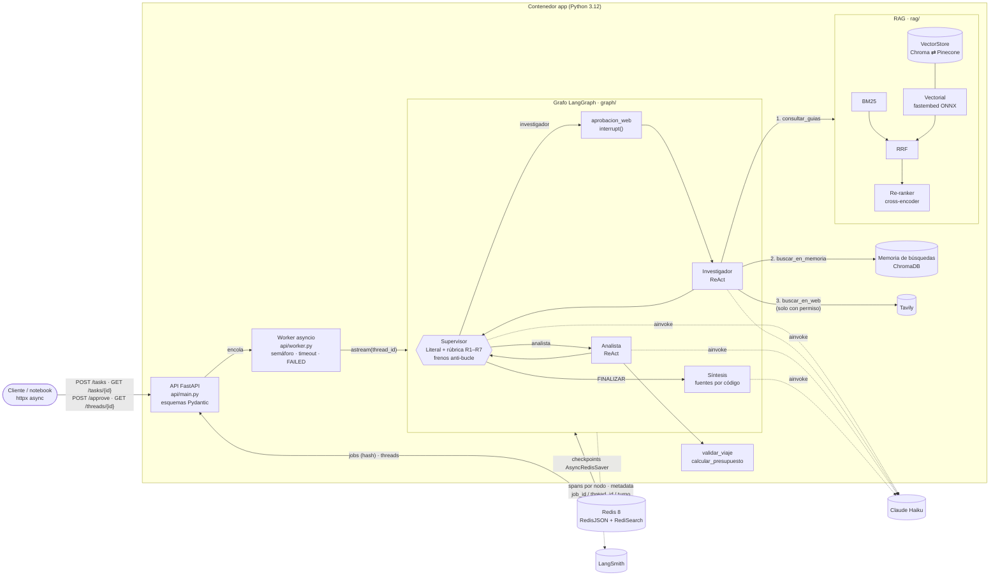
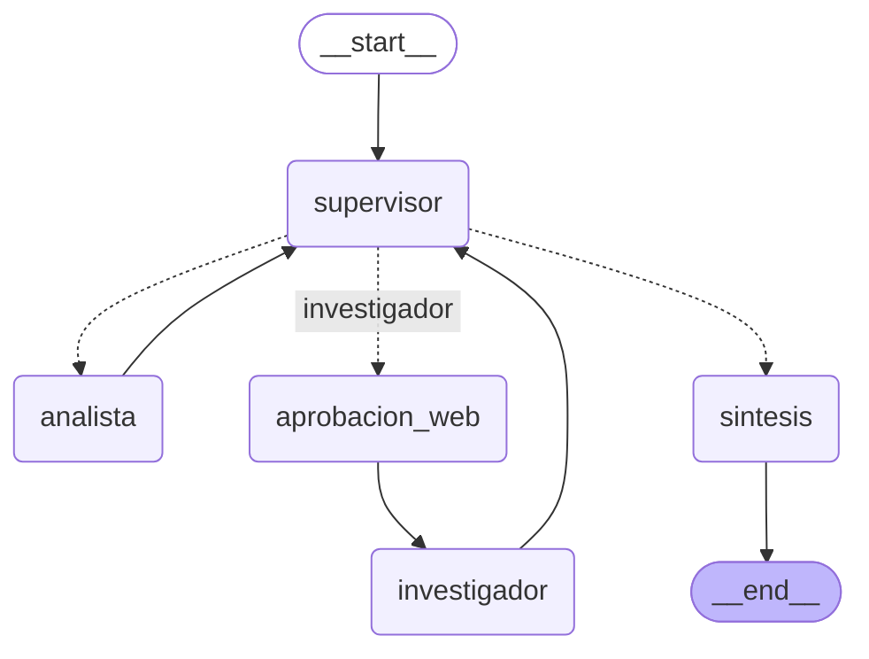
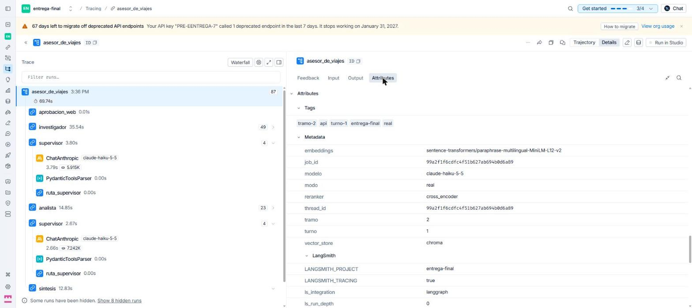
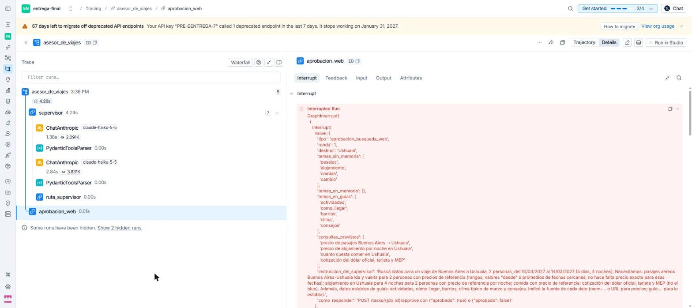
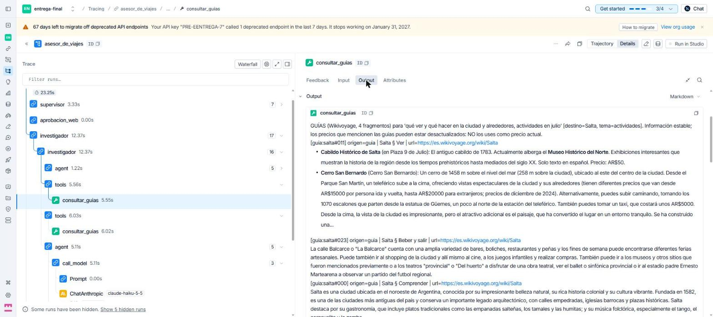
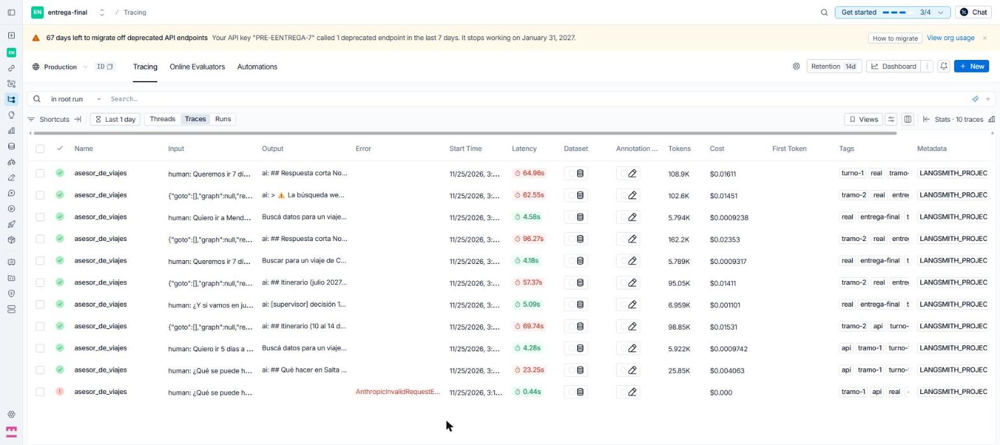
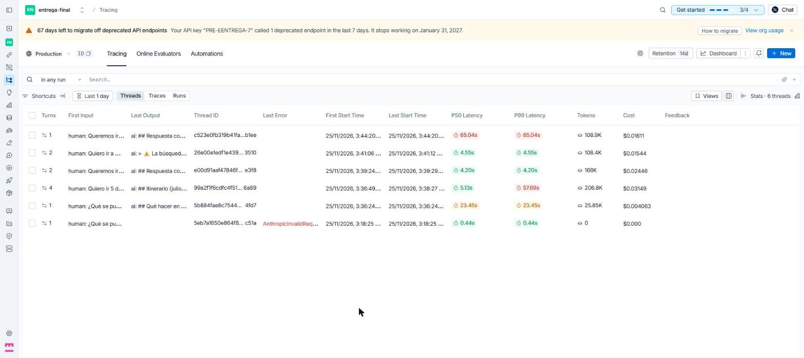
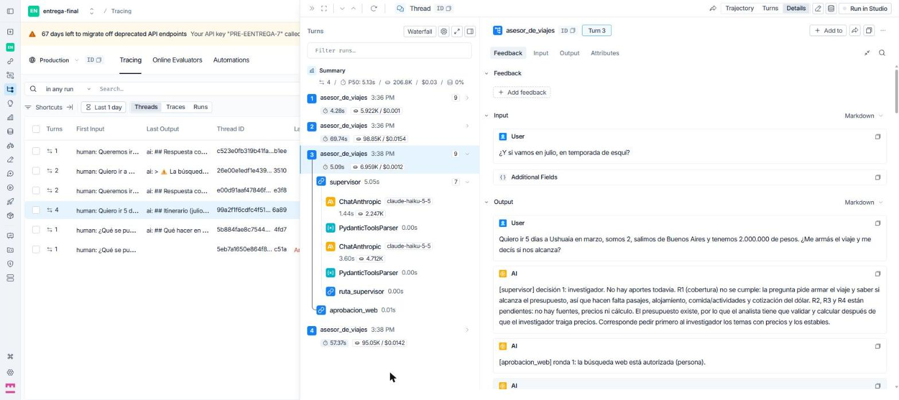
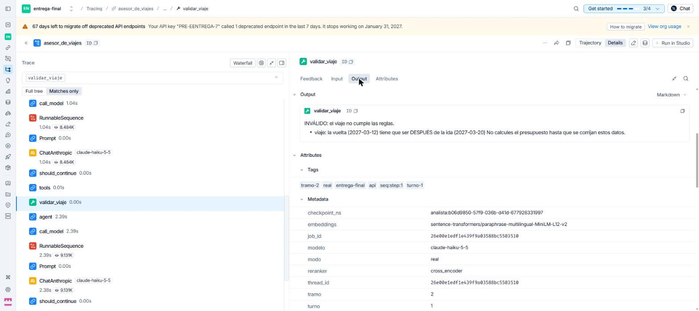
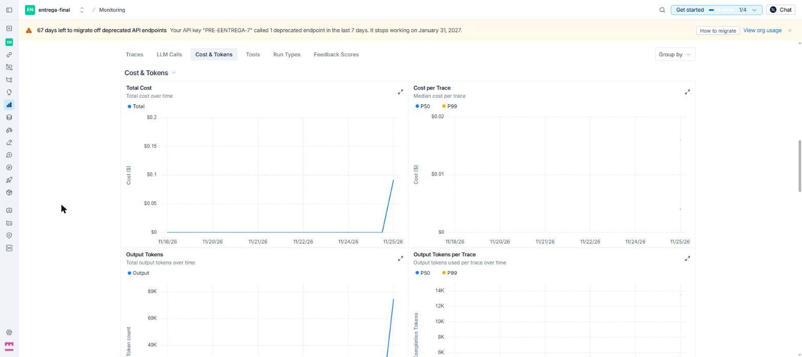

# Asesor de viajes multi-agente · Entrega final AI Engineering

**En 5 minutos, para un ingeniero senior.** Es un sistema de inteligencia de viajes por Argentina. Una **API FastAPI 100% async** recibe la pregunta, guarda el job en **Redis** y vuelve al instante. Un worker de asyncio corre un **grafo LangGraph jerárquico**: un **supervisor** con salida estructurada (`Literal`), una rúbrica y frenos anti-bucle decide quién trabaja. El **investigador** es un agente ReAct que resuelve lo estable con un **RAG propio** sobre 9 guías de Wikivoyage: chunking por tokens, búsqueda híbrida BM25 + vectorial con fusión RRF, re-ranking con cross-encoder y filtro por destino desde los metadatos. Lo que cambia (precios, tipo de cambio) lo saca de una memoria semántica de búsquedas y, solo si una **persona lo aprueba (human-in-the-loop con `interrupt()`)**, de la web con Tavily. El **analista** valida el viaje y calcula el presupuesto con herramientas determinísticas. Una **síntesis** redacta la respuesta; las **fuentes y la atribución las agrega el código**, nunca el LLM. Cada paso queda en un **checkpointer de LangGraph en Redis** (`AsyncRedisSaver`): las pausas y las **conversaciones de varios turnos sobreviven a un reinicio** de la API. Todo se traza en **LangSmith** con metadata `job_id` / `thread_id` / `turno`, y todas las entradas y salidas (API y herramientas) están validadas con **Pydantic**. Se levanta con **`docker compose up`**; hay modo mock sin claves y 188 tests que corren sin claves.

---

## Índice

1. [Qué resuelve y para quién](#1-qué-resuelve-y-para-quién)
2. [Arquitectura](#2-arquitectura)
3. [El grafo (Mermaid generado desde el código)](#3-el-grafo-mermaid-generado-desde-el-código)
4. [Cómo levantarlo: un comando](#4-cómo-levantarlo-un-comando)
5. [Endpoints con ejemplos](#5-endpoints-con-ejemplos)
6. [El RAG: corpus, ingesta, retriever y métricas](#6-el-rag-corpus-ingesta-retriever-y-métricas)
7. [Conversaciones que sobreviven a un reinicio](#7-conversaciones-que-sobreviven-a-un-reinicio)
8. [Las 5 pruebas de punta a punta, con capturas de LangSmith](#8-las-5-pruebas-de-punta-a-punta-con-capturas-de-langsmith)
9. [Observabilidad](#9-observabilidad)
10. [Async y Pydantic de punta a punta](#10-async-y-pydantic-de-punta-a-punta)
11. [Decisiones de arquitectura y alternativas descartadas](#11-decisiones-de-arquitectura-y-alternativas-descartadas)
12. [Rúbrica → dónde se cumple](#12-rúbrica--dónde-se-cumple)
13. [Qué módulo del curso aporta qué capa](#13-qué-módulo-del-curso-aporta-qué-capa)
14. [Devolución de la PE7 y fortalezas que se mantienen](#14-devolución-de-la-pe7-y-fortalezas-que-se-mantienen)
15. [Lo que aprendimos en el camino](#15-lo-que-aprendimos-en-el-camino)
16. [Tests](#16-tests)
17. [Estructura del repositorio](#17-estructura-del-repositorio)
18. [Limitaciones](#18-limitaciones)
19. [Licencia del corpus](#19-licencia-del-corpus)

---

## 1. Qué resuelve y para quién

**Para quién:** alguien que planea un viaje por Argentina y quiere, en una sola pregunta, un plan concreto, por ejemplo: *"7 días a Bariloche en enero, somos 2, salimos de Mendoza, tenemos $800.000: ¿nos alcanza?"*. También sirve para una agencia chica que quiere automatizar la primera respuesta sin perder control del gasto.

**Qué resuelve:**

- **Lo estable** (qué ver y hacer, cómo llegar, barrios, clima típico del mes, consejos) sale de una **base de conocimiento propia** con fuente exacta (artículo + sección de Wikivoyage). Es gratis, instantáneo y no alucina URLs.
- **Lo que cambia** (pasajes, alojamiento, comida, dólar oficial/tarjeta/MEP) sale de búsquedas recientes guardadas o de la web, **solo con permiso humano** cuando hay que gastar.
- **Las cuentas** (noches, personas, conversión de moneda, si entra en el presupuesto y alternativas si no) las hacen herramientas determinísticas, no el LLM.
- **La conversación sigue**: *"¿y si vamos en julio?"* mantiene destino, personas y presupuesto, y recalcula, aunque la API se haya reiniciado en el medio.

---

## 2. Arquitectura



| Capa | Carpeta | Qué hace |
|---|---|---|
| Configuración | `config.py`, `.env.example` | Todas las variables (modelos, índices, URLs, límites) validadas con **pydantic-settings**. Nada hard-codeado. |
| Agentes | `agents/` | Cliente LLM (`llm.py`), supervisor, investigador y analista con sus herramientas, síntesis y modo mock. |
| Grafo | `graph/` | Estado (`state.py`), armado del grafo (`builder.py`), nodo HITL (`hitl.py`), checkpointer (`checkpointer.py`). |
| RAG | `rag/` | Corpus, chunking, embeddings, vector store (Chroma/Pinecone), retriever híbrido, re-rankers, ingesta y evaluación. También la memoria de búsquedas. |
| API | `api/` | FastAPI, esquemas Pydantic, `JobStore` en Redis y worker. |
| Observabilidad | `observability/` | LangSmith (metadata, tags, costo) y la traza local versionada en `traces/`. |

---

## 3. El grafo (Mermaid generado desde el código)

Este diagrama **no está dibujado a mano**: es la salida de `python main.py --mock --mermaid` (`graph.get_graph().draw_mermaid()`), guardada en [`docs/grafo.mmd`](docs/grafo.mmd).



| Nodo | Qué hace | Qué escribe en el estado (lo controla `validar_actualizacion()`) |
|---|---|---|
| `supervisor` | En el primer paso de cada turno extrae el `PedidoViaje` (en un seguimiento lo combina con el del turno anterior). Después decide `investigador` / `analista` / `FINALIZAR` con salida estructurada y una rúbrica (R1 cobertura, R2 fuentes, R3 precios, R4 cálculo, R5 observaciones, R6 coherencia, **R7 economía**). Reglas duras por código y freno `MAX_PASOS_SUPERVISOR`. | `pedido`, `decisiones`, `siguiente`, `instruccion_actual`, `temas_pedidos` |
| `aprobacion_web` | Human-in-the-loop sin LLM. Para cada tema pedido mira si lo responden **las guías** (tema estable + destino con guía) o **la memoria** (datos vigentes). Solo si queda algo sin cubrir llama a `interrupt()` y el job pasa a `WAITING_APPROVAL`. | `permiso_web`, `aprobaciones` |
| `investigador` | ReAct con `consultar_guias` → `buscar_en_memoria` → `buscar_en_web`. Contexto acotado: solo la instrucción y el pedido. Un chequeo por código anota observaciones (sin fuentes, sin precios, web caída). | `aportes` (con `fuentes` de los artifacts) |
| `analista` | ReAct con `validar_viaje` y `calcular_presupuesto` (determinísticas). Si no entra, calcula una alternativa. | `aportes` |
| `sintesis` | Redacta la respuesta. El código agrega la lista de fuentes, el aviso de precios y la atribución CC BY-SA, y registra el turno. | `respuesta_final`, `turnos` |

Frenos contra el "supervisor infinito": `MAX_PASOS_SUPERVISOR=6`, `RECURSION_LIMIT=20` en el grafo, `RECURSION_LIMIT_ESPECIALISTA=12` en cada ReAct, y como máximo 2 rondas del investigador.

---

## 4. Cómo levantarlo: un comando

**Con Docker (recomendado), en una máquina limpia:**

```bash
git clone https://github.com/anukvilarasau/entrega-final.git && cd entrega-final
cp .env.example .env        # completá ANTHROPIC_API_KEY, TAVILY_API_KEY y (opcional) LANGSMITH_API_KEY
docker compose up --build   # app + Redis 8; la ingesta del RAG corre sola al arrancar
```

- API en <http://localhost:8000/docs> (OpenAPI con ejemplos).
- **Sin claves:** `MODO_MOCK=1 docker compose up --build`. El LLM y Tavily quedan simulados con políticas que reaccionan a lo que devuelven las herramientas reales.
- La imagen (~3,6 GB) trae **horneados** los modelos ONNX (embeddings, re-ranker y el embedding de la memoria): al arrancar no descarga nada. El índice de las guías, la memoria de búsquedas y Redis viven en **volúmenes**, así que sobreviven a `docker compose restart` / `down` / `up`.

**Sin Docker (Python 3.12):**

```bash
./run.sh            # Linux / macOS / Git Bash: crea .venv, instala, ingesta, uvicorn
./run.sh --mock     # sin claves
./run.sh --tests    # los tests
```
```powershell
.\run.ps1           # Windows PowerShell (también -Mock y -Tests)
```

Sin `REDIS_URL` se usan fakeredis e `InMemorySaver` (sirve para probar, pero nada persiste). Con Redis 8 / Redis Stack o Redis Cloud, los checkpoints persisten.

**Utilidades:** `python -m rag.ingesta [--forzar]` · `python -m rag.evaluate` · `python main.py "pregunta"` (consola) · `python scripts/pruebas_finales.py` (las 5 pruebas).

---

## 5. Endpoints con ejemplos

| Método | Ruta | Para qué | Respuesta |
|---|---|---|---|
| POST | `/tasks` | Encolar una pregunta, o un **seguimiento** con `thread_id` | `202 TaskCreada` (`job_id`, `thread_id`, `turno`) |
| GET | `/tasks/{job_id}` | Estado, progreso (`ruta`, `nodo_actual`), pausa HITL, resultado, error, tokens y costo | `JobInfo` |
| POST | `/tasks/{job_id}/approve` | Responder la pausa: `{"aprobado": true\|false}` | `202 AprobacionAceptada` |
| GET | `/tasks` | Últimos jobs | `list[JobInfo]` |
| GET | `/threads/{thread_id}` | Historial de la conversación, leído del **checkpoint** | `ConversacionInfo` |
| GET | `/rag/buscar?q=&destino=&k=` | El retriever solo (diagnóstico, sin LLM) | `ResultadoBusqueda` |
| GET | `/health` | Redis, checkpointer, RAG, LangSmith, jobs activos | `HealthInfo` |

Errores controlados: `404` (job o conversación inexistente), `409` (el job no espera aprobación, o la conversación tiene un job sin terminar) y `422` (validación Pydantic: pregunta corta, campo desconocido, `thread_id` mal formado).

```bash
# 1. Encolar (vuelve al instante)
curl -s -X POST localhost:8000/tasks -H 'Content-Type: application/json' \
  -d '{"pregunta":"Quiero ir 7 días a Bariloche en enero, somos 2, salimos de Mendoza y tenemos 800.000 pesos. ¿Nos alcanza?"}'
# {"job_id":"…","thread_id":"…","turno":1,"estado":"PENDING","links":{…}}

# 2. Polling: si queda en WAITING_APPROVAL, "aprobacion_pendiente" dice qué temas iría a buscar a la web
#    (y cuáles ya responden las guías o la memoria)
curl -s localhost:8000/tasks/<job_id>

# 3. Aprobar (o {"aprobado": false}: sigue solo con guías y memoria)
curl -s -X POST localhost:8000/tasks/<job_id>/approve -H 'Content-Type: application/json' -d '{"aprobado": true}'

# 4. Seguir la conversación, aunque la API se haya reiniciado
curl -s -X POST localhost:8000/tasks -H 'Content-Type: application/json' \
  -d '{"pregunta":"¿Y si vamos en julio?","thread_id":"<thread_id>"}'
curl -s localhost:8000/threads/<thread_id>

# El RAG solo
curl -s 'localhost:8000/rag/buscar?q=dónde%20esquiar&destino=Bariloche&k=3'
```

El notebook [`demo.ipynb`](demo.ipynb) hace todo esto contra la API real y quedó **ejecutado, con sus salidas**.

---

## 6. El RAG: corpus, ingesta, retriever y métricas

### Corpus propio: guías de Wikivoyage en español

[`data/guias/`](data/guias/) tiene 9 guías: Bariloche, Mendoza, Salta, Ushuaia, Puerto Madryn, Mar del Plata, Córdoba, Iguazú y El Calafate. Suman ~267.000 caracteres en **markdown versionado en el repo**, así que la ingesta es reproducible sin internet. Las descarga [`scripts/descargar_guias.py`](scripts/descargar_guias.py) desde la API de MediaWiki, con la revisión exacta de cada artículo.

- **Por qué un conversor propio** ([`rag/wikitexto.py`](rag/wikitexto.py)): el "texto plano" de la API descarta las **fichas de lugares** (`{{ver|name=Cerro Catedral|content=…}}`, `{{comer}}`, `{{dormir}}`) y la tabla **`{{Clima}}`** con máximas, mínimas y lluvias por mes, que son justo lo más útil. El conversor las transforma en ítems y en una tabla markdown, y tira banners, mapas e imágenes.
- **Licencia y atribución:** cada archivo tiene un encabezado YAML con `url`, `revision`, `licencia: CC BY-SA 4.0` y la atribución. [`data/guias/_ATRIBUCION.md`](data/guias/_ATRIBUCION.md) las lista todas con el enlace al historial (los autores). Ver §19.

### Ingesta idempotente ([`rag/ingesta.py`](rag/ingesta.py))

1. **Limpieza y secciones:** un fragmento nunca mezcla dos secciones; la ruta (`Hacer > Senderismo`) va en los metadatos.
2. **Chunking por tokens:** hasta **500 tokens con 60 de solapamiento**, medidos con el **tokenizer del propio modelo de embeddings**. El corte se corre al último fin de párrafo, ítem u oración. El texto se toma del original con los *offsets* del tokenizer, así no se pierden tildes.
3. **Metadatos:** `destino`, `slug`, `seccion`, `url`, `titulo`, `licencia`, `tokens`, `doc_hash`.
4. **Embeddings** con `EMBEDDINGS_MODELO` (por defecto `paraphrase-multilingual-MiniLM-L12-v2` vía fastembed ONNX, sin torch). Ese modelo **trunca en 128 tokens**, así que cada fragmento se embebe por ventanas de 120 tokens que se promedian: el vector representa el fragmento entero.
5. **Idempotencia:** `doc_hash` = hash del documento + "huella" (modelo, tamaño, overlap). Si nada cambió, no se recalcula ningún embedding (la segunda corrida tarda 0,35 s). Si cambia una guía, se reindexa **solo esa**; si se borra, se borran sus fragmentos. Si cambia el modelo o el tamaño de chunk, se reindexa todo. Los tests lo verifican.

Resultado: **246 fragmentos** en el índice real, en ~12 s la primera vez. La API corre la ingesta sola al arrancar (`INGESTA_AL_ARRANCAR=true`).

### Retriever híbrido ([`rag/retriever.py`](rag/retriever.py))

```
consulta ─┬─► embedding ─► VectorStore.buscar(slug) ─ top 20 ─┐
          │                                                     ├─► RRF (k=60) ─► top 12 ─► re-ranker ─► top 4
          └─► BM25 (mismos fragmentos, mismo slug)    ─ top 20 ─┘
```

- **Filtro por destino desde los metadatos:** "Cataratas", "Puerto Iguazú" o "San Carlos de Bariloche" se resuelven al `slug` por los alias del corpus. Si el destino no tiene guía, `destino_sin_guia=True` y el investigador pasa a la memoria o la web.
- **Vector store detrás de una interfaz** (`VectorStore`): **ChromaDB** persistente por defecto (corre en Docker sin claves) y **Pinecone** serverless (cliente async nativo) con `VECTOR_STORE=pinecone`. Ningún agente se entera del cambio. Pinecone está probado con un índice falso en los tests.
- **Re-ranking configurable** (`RERANKER`): `cross_encoder` por defecto (`jinaai/jina-reranker-v2-base-multilingual`, ONNX), `llm` (Claude puntúa con salida Pydantic) o `ninguno`.
- **Las fuentes salen siempre de los metadatos del fragmento** (`Fuente(origen="guia", ref="guia:bariloche#014", url, seccion, licencia)`), nunca del texto que escribe el LLM.

### Métricas ([`rag/evaluate.py`](rag/evaluate.py), golden set de 15 preguntas en [`data/golden_set.json`](data/golden_set.json))

Cada pregunta tiene su guía esperada y qué fragmentos son relevantes (por sección o por palabras clave). Se mide en dos niveles: **documento** (sin filtro, sobre las 9 guías) y **fragmento** (con el filtro de destino que usa el agente). Resultado completo en [`docs/evaluacion/evaluacion_rag.md`](docs/evaluacion/evaluacion_rag.md).

| Modo (k = 4) | Recall@1 doc | Precision@4 doc | Recall@4 frag | Precision@4 frag | MRR | ms/consulta |
|---|---|---|---|---|---|---|
| Solo vectorial | 0,80 | 0,63 | 0,59 | 0,35 | 0,62 | 9 |
| Solo BM25 | 0,80 | 0,80 | 0,73 | 0,47 | 0,72 | 1 |
| Híbrido (RRF) | 0,93 | 0,82 | 0,58 | 0,37 | 0,73 | 10 |
| **Híbrido + re-ranker** | **1,00** | **0,93** | **0,78** | **0,48** | **0,82** | 2.446 |

**Lectura honesta:**
- El **re-ranker es lo que más suma**: +0,20 de recall y +0,09 de MRR sobre el híbrido, y lleva a 1,00 el acierto de la guía en el primer puesto.
- El **RRF solo no le gana a BM25** en recall de fragmentos, porque el embedding multilingüe chico es el eslabón débil (0,59). Sí mejora el acierto del documento (0,80 → 0,93).
- **El costo es latencia:** ~2,4 s de CPU por consulta.

Comparación de re-rankers (mismos datos, en [`docs/evaluacion/`](docs/evaluacion/)):

| Re-ranker | Candidatos · caracteres | Recall@4 frag | MRR | ms/consulta |
|---|---|---|---|---|
| **jina-reranker-v2-base-multilingual** (elegido) | 12 · 1.200 | **0,78** | **0,82** | 2.404 |
| jina-reranker-v2-base-multilingual | 8 · 800 | 0,64 | 0,80 | 1.258 |
| bge-reranker-v2-m3 (int8) | 8 · 800 | 0,68 | 0,80 | 1.558 |

---

## 7. Conversaciones que sobreviven a un reinicio

- **Un thread = una conversación.** El primer `POST /tasks` crea el thread (`thread_id = job_id`). Cada seguimiento (`POST /tasks` con `thread_id`) es un **job nuevo en el mismo thread** de LangGraph.
- **Entrada de un turno** (`entrada_turno`): solo se reinician los campos "de la corrida" (pregunta, pedido, contadores, permiso web). `aportes`, `decisiones`, `aprobaciones` y `turnos` tienen reductores que **suman**, así que quedan como historial. Cada registro lleva su `turno` y los nodos solo miran el turno actual.
- **El pedido se arrastra:** el supervisor recibe el `PedidoViaje` del turno anterior y el LLM devuelve el pedido completo actualizado. Lo que deje en `null` lo completa **el código** (`combinar_pedidos`): si cambió la ida y no la vuelta, la vuelta se recalcula con los días.
- **Persistencia:** el checkpoint vive en Redis (`AsyncRedisSaver` + RedisJSON/RediSearch, TTL configurable). Después de `docker compose restart app`, `GET /threads/{id}` y el turno siguiente leen el estado guardado (prueba 3 de §8 y los tests `test_conversaciones.py`, también contra Redis real).
- **Reglas:** un solo job activo por conversación (409 si no), y 404 si el thread no existe en el checkpointer.

---

## 8. Las 5 pruebas de punta a punta, con capturas de LangSmith

Corridas con [`scripts/pruebas_finales.py`](scripts/pruebas_finales.py) contra el stack de **`docker compose up` en modo real** (Claude Haiku + Tavily + LangSmith, Redis 8 del compose, memoria e índice en volúmenes). Cada fila enlaza el job completo (respuesta, ruta, eventos, tokens) en [`traces/pruebas_finales/`](traces/pruebas_finales/). El resumen está en [`resultados.md`](traces/pruebas_finales/resultados.md).

| # | Escenario (qué demuestra) | Estado · turno | Pausa HITL → permiso web | Ruta del grafo | Fuentes guía / memoria / web | Búsquedas web | ¿Entra? · validación | Latencia LangSmith | Tokens | Costo US$ (LangSmith = propio) |
|---|---|---|---|---|---|---|---|---|---|---|
| 1 | [solo_guias](traces/pruebas_finales/1_solo_guias.json) — RAG sin pausa: lo estable sale de las guías (0 búsquedas web, sin analista) | DONE · 1 | no → sin_pedir | sup → HITL → inv → sup → sín | 6 / 0 / 0 | 0 | — · — | 23.25 s (1 tramo) | 25.846 | 0.0041 = 0.0041 |
| 2 | [flujo_completo](traces/pruebas_finales/2_flujo_completo.json) — Flujo completo: guías + pausa HITL + web + analista + síntesis | DONE · 1 | sí → aprobada | sup → HITL → inv → sup → ana → sup → sín | 17 / 0 / 12 | 4 | sí · válido | 74.02 s (2 tramos) | 104.767 | 0.0163 = 0.0163 |
| 3 | [seguimiento_tras_reinicio](traces/pruebas_finales/3_seguimiento_tras_reinicio.json) — Follow-up después de `docker compose restart app`: recuerda el pedido (checkpoint en Redis) | DONE · 2 | sí → aprobada | sup → HITL → inv → sup → ana → sup → sín | 7 / 9 / 3 | 1 | sí · válido | 62.46 s (2 tramos) | 102.004 | 0.0152 = 0.0152 |
| 4 | [no_alcanza](traces/pruebas_finales/4_no_alcanza.json) — Presupuesto insuficiente: el analista lo detecta y propone una alternativa | DONE · 1 | no → sin_pedir | sup → HITL → inv → sup → ana → sup → sín | 10 / 13 / 0 | 0 | **no** (+ alternativa) · válido | 64.96 s (1 tramo) | 108.940 | 0.0161 = 0.0161 |
| 5 | [error_controlado](traces/pruebas_finales/5_error_controlado.json) — Error controlado: fechas imposibles + web rechazada → DONE pidiendo corregir | DONE · 1 | sí → rechazada | sup → HITL → inv → sup → HITL → inv → sup → ana → sup → sín | 12 / 3 / 0 | 0 | — · **INVÁLIDO** | 67.13 s (2 tramos) | 108.354 | 0.0154 = 0.0154 |
| | **Total** | | | | | | | 291.8 s | 449.911 | **0.0671** |

`sup` = supervisor, `HITL` = aprobacion_web, `inv` = investigador, `ana` = analista, `sín` = síntesis. **Latencia** es el tiempo del grafo según LangSmith, sumando los tramos (sin la espera humana). **Costo** es el de LangSmith, que coincide exactamente con el que calcula el sistema en `GET /tasks/{id}`.

**Qué se ve en cada una:**

1. **Solo guías.** El supervisor pidió solo `actividades` y `clima` (R7: economía). El HITL vio que las guías cubren todo y **no pausó** (`sin_pedir`). El investigador usó solo `consultar_guias`: 6 fuentes de Wikivoyage (incluida la tabla de clima de julio), 0 búsquedas web y sin analista. Fue la más barata (US$0,004).
2. **Flujo completo con HITL.** La pausa pidió permiso **solo** por `pasajes, alojamiento, comida, cambio`; `actividades, como_llegar, barrios, clima, consejos` ya los cubrían las guías. Después del approve: 4 búsquedas web, el analista validó y calculó (entra en el presupuesto), y la síntesis citó 17 fragmentos de guía y 12 URLs.
3. **Seguimiento después de `docker compose restart app`** (16 s de reinicio). "¿Y si vamos en julio, en temporada de esquí?" en el **mismo thread** es el turno 2: recordó Ushuaia, Buenos Aires, 2 personas y $2.000.000, y solo cambió las fechas a 10–14/07. La **memoria de búsquedas del volumen** ya tenía alojamiento, comida y cambio, así que la pausa pidió permiso **solo por pasajes** (1 búsqueda web). El itinerario pasó a esquí en el Glaciar Martial y trineos con huskies.
4. **Presupuesto que no alcanza.** Con $350.000 para El Calafate, el pasaje solo ya cuesta casi el doble: el analista dio **NO ENTRA** y calculó una alternativa más corta, que tampoco entra. Esta es la segunda corrida (ver abajo), y salió **sin pausa ni web**: los precios estaban en la memoria del volumen desde la primera.
5. **Error controlado.** Fechas imposibles ("del 20 al 12 de marzo") y la persona **rechazó** la web. El grafo no se rompe: termina en `DONE`, `validar_viaje` da **INVÁLIDO**, no se suponen otras fechas, y la síntesis avisa que la web no fue autorizada y pide corregir. La misma prueba verifica los errores HTTP controlados: 404 (job y thread inexistentes) y 422 (pregunta corta, campo desconocido).

**Dos corridas que no quedaron en la tabla, y por qué** (las dos son evidencia de cosas que se corrigieron):
- **Prueba 1, primer intento:** FAILED con `credit balance is too low`, porque la cuenta de Anthropic no tenía saldo. El job terminó en FAILED con el error completo y su traza llegó a LangSmith (fila roja en la captura 5). Evidencia: [`_corrida_sin_saldo_anthropic.json`](traces/pruebas_finales/_corrida_sin_saldo_anthropic.json).
- **Prueba 4, primer intento** (US$0,0245): la respuesta decía bien "no alcanza", pero la **métrica** `presupuesto_entra` daba `True`. La traza guarda los primeros 600 caracteres de cada resultado de herramienta, y la línea `RESULTADO: NO ENTRA` del primer cálculo, con 6 renglones, había quedado después del corte. Se corrigió `resumir_resultado()` para que el veredicto no se pierda nunca, se agregó un test de regresión y se repitió la prueba.

**Costo real total de la etapa de pruebas:** US$0,0671 por las 5 de la tabla, más US$0,0245 del primer intento de la prueba 4 y ~US$0,043 del notebook ejecutado. En total, **~US$0,135 de Claude Haiku y ~15 búsquedas de Tavily**.


### Capturas del dashboard de LangSmith (proyecto `entrega-final`)

**Traza completa de la prueba 2 (tramo después de la aprobación):** el árbol de spans del grafo (`aprobacion_web → investigador → supervisor → analista → supervisor → sintesis`) y la **metadata** de cada run (`job_id`, `thread_id`, `turno`, `tramo`, `modelo`, `embeddings`, `reranker`, `vector_store`).



**Pausa HITL (prueba 2, tramo 1):** el grafo se detiene en `aprobacion_web` con `interrupt()`. El valor del interrupt dice qué iría a la web (`temas_sin_memoria`) y qué ya cubren las guías (`temas_en_guias`), sin gastar.



**El RAG en la traza (prueba 1):** el investigador solo llamó a `consultar_guias`. Cada fragmento trae su ID (`guia:salta#011`), el artículo, la sección y la URL de Wikivoyage, sacados de los metadatos.



**Costo y latencia por ejecución:** cada traza (un tramo de un job) con su latencia, tokens y costo, incluida la corrida fallida por falta de saldo (en rojo, `AnthropicInvalidRequestError`).



**Threads: latencia P50/P99 y costo por conversación.** El thread `99a2f1f6…` tiene 4 ejecuciones: los 2 tramos del turno 1 (pausa y reanudación) y los 2 del seguimiento después del reinicio.



**El seguimiento después del reinicio (prueba 3):** turno 2 del mismo thread. La entrada es "¿Y si vamos en julio, en temporada de esquí?" y el estado trae los mensajes del turno 1, restaurados del checkpoint de Redis.



**Error controlado (prueba 5):** `validar_viaje` responde INVÁLIDO (la vuelta es anterior a la ida), con `tramo-2` después del rechazo humano.



**Costo y tokens agregados del proyecto (Monitoring):**



> El banner amarillo ("1 deprecated endpoint in the last 7 days") corresponde a **un** llamado de esta misma mañana con el `list_runs()` del SDK. Ya se reemplazó por `client.runs.query_v2()` (§9), así que el aviso desaparece solo cuando pasen los 7 días.


---

## 9. Observabilidad

- **Trazas por nodo:** LangGraph abre un span por nodo (`supervisor`, `aprobacion_web`, `investigador`, `analista`, `sintesis`) y, adentro, el subagente ReAct, cada herramienta y cada llamada a Claude. [`observability/monitoreo.py`](observability/monitoreo.py) les pone **metadata** (`job_id`, `thread_id`, `turno`, `tramo`, `modo`, `modelo`, `embeddings`, `reranker`, `vector_store`) y **tags** (`api`, `real|mock`, `tramo-N`, `turno-N`). La vista *Threads* de LangSmith agrupa los tramos de una pausa HITL y los turnos de una conversación.
- **Costo por ejecución, doble:** LangSmith lo calcula con su tabla de precios, y cada job guarda su propio costo (tokens × precios configurados) en `GET /tasks/{id}`, para que se vea sin abrir el dashboard.
- **Traza local versionada:** cada job real deja `traces/api/*.json|.log` (ruta, decisiones con su evaluación, llamadas a herramientas con argumentos y resultado, fuentes, cobertura por tema, métricas). Las pruebas finales quedan en `traces/pruebas_finales/`.
- **SDK actualizado:** `langsmith==0.16.2`. El SDK anterior usaba `list_runs()`, que **deja de funcionar el 31/01/2027**: es el aviso que mostraba LangSmith. Los scripts consultan con `client.runs.query_v2()`.

---

## 10. Async y Pydantic de punta a punta

| Componente | Cliente | Cómo no bloquea el event loop |
|---|---|---|
| Claude | `ChatAnthropic.ainvoke` | Async nativo |
| Tavily | `TavilySearch.ainvoke` | Async nativo (aiohttp) |
| Redis (jobs) | `redis.asyncio` | Async nativo, pool bloqueante con tope de conexiones |
| Checkpointer | `AsyncRedisSaver` | Async nativo |
| Pinecone | `PineconeAsyncio` / `IndexAsyncio` | Async nativo |
| ChromaDB (índice y memoria) | `PersistentClient` (sync) | `asyncio.to_thread` en cada llamada |
| fastembed (embeddings y cross-encoder) | ONNX Runtime (CPU, sync) | `asyncio.to_thread` |
| BM25 (`rank-bm25`) | CPU, sync | `asyncio.to_thread` |
| Arranque (cargar modelos, Chroma) | sync | `run_in_threadpool` en el lifespan |
| Trazas locales (disco) | sync | `asyncio.to_thread` |
| Herramientas del analista | funciones puras (µs) | LangChain las corre en un executor |

**No queda ningún `requests`**: [`tests/test_auditoria.py`](tests/test_auditoria.py) recorre el AST de toda la app y falla si aparece `requests`/`urllib`, o un `time.sleep` dentro de un `async def`. El único `urllib` está en `scripts/descargar_guias.py`, un script de descarga única fuera de la API, dentro de `asyncio.to_thread` y documentado (httpx recibe 403 del filtro anti-bots de Wikimedia).

**Pydantic en todo:**
- **API:** entradas (`TaskRequest`, `AprobacionRequest`, con `extra="forbid"`) y `response_model` en todos los endpoints, con ejemplos en OpenAPI ([`api/schemas.py`](api/schemas.py)).
- **Herramientas:** `args_schema` en todas, y su salida pasa por `SalidaHerramienta` / `ResultadoValidacion` antes de volver al LLM.
- **Estado del grafo:** `Aporte`, `Fuente`, `DecisionSupervisor`, `PedidoViaje`, `TurnoConversacion`...
- **Configuración:** `config.Ajustes` (pydantic-settings).
- **RAG:** `Fragmento`, `ResultadoBusqueda`, `ReporteIngesta`.

El test de auditoría también verifica que todo endpoint declare `response_model`, que toda herramienta tenga `args_schema` y que `.env.example` documente **todas** las variables de `config.Ajustes`.

---

## 11. Decisiones de arquitectura y alternativas descartadas

| Decisión | Por qué | Alternativa descartada |
|---|---|---|
| **El RAG como herramienta del investigador** (`consultar_guias`), no como nodo aparte | El agente decide cuándo consultar, igual que con la memoria y la web; el supervisor y la rúbrica no cambian de forma. | Un nodo "retriever" fijo antes del supervisor: recupera aunque la pregunta sea solo de precios. |
| **Estable → guías; volátil → memoria/web con HITL** | Las guías no gastan ni requieren permiso, y la web se reserva para lo que cambia. El HITL pausa solo por lo que nadie cubre. | Buscar todo en la web (caro, y la PE7 pausaba casi siempre). |
| **Fuentes desde los metadatos** | Imposible inventar una URL: el LLM cita IDs y el código arma la lista. | Pedirle al LLM que liste las fuentes. |
| **Corpus versionado en el repo** | Ingesta reproducible sin internet, en Docker y en CI. | Descargar en cada arranque. |
| **Conversor de wikitexto propio** | Conserva fichas y tabla de clima. | Texto plano de TextExtracts (las pierde). |
| **Chunking por tokens del modelo, respetando secciones** | Metadatos de sección precisos y fragmentos que entran en la ventana del re-ranker. | Chunking por caracteres o por párrafos sin tope. |
| **fastembed (ONNX) en lugar de sentence-transformers** | Sin torch: la imagen no lleva ~2 GB extra y arranca rápido. | sentence-transformers (como en la PE4). |
| **Cross-encoder multilingüe configurable** | Mejor métrica, gratis y determinístico; `evaluate.py` no gasta. | Re-ranker con LLM por defecto (gasta y suma 1–2 s de red); cross-encoders en inglés (~80 MB, malos en español). |
| **Chroma por defecto, Pinecone por variable** | Docker sin claves ni servicios externos; Pinecone para escalar sin tocar agentes. | Solo Pinecone (como la PE4): obliga a tener cuenta para correr. |
| **Thread ≠ job; reductores que suman + `turno`** | Historial auditable completo y reinicio seguro. | Reiniciar listas con un reductor especial: los *pending writes* del checkpoint en JSON pueden perder el marcador. |
| **`combinar_pedidos` por código** | El seguimiento no depende de que el LLM copie bien todos los campos. | Confiar en que el LLM devuelva el pedido completo. |
| **Modelos horneados en la imagen** | `docker compose up` arranca sin descargar nada. | Descargar al primer arranque (la primera consulta tardaría minutos). |
| **Un proceso con worker asyncio** | Lo pide la consigna (sin Celery/Arq); estado y checkpoints ya están en Redis. | Cola externa (Celery/Arq/RQ). |

---

## 12. Rúbrica → dónde se cumple

| Criterio (peso) | Dónde se cumple |
|---|---|
| **Arquitectura y coherencia (30%)**: LLMs + RAG + agentes en un flujo unificado | §2–§3, §6. RAG propio (`rag/`) como herramienta del investigador (`agents/research_tools.py`), supervisor con rúbrica R1–R7 (`agents/supervisor.py`), HITL que mira guías y memoria (`graph/hitl.py`), síntesis con fuentes por código (`agents/synthesizer.py`). Métricas del RAG en §6 y pruebas en §8. |
| **Asincronía y validación Pydantic (25%)** | §10. Tabla de clientes async, `asyncio.to_thread` donde el cliente es sync, `api/schemas.py`, `SalidaHerramienta`, `config.Ajustes`. Verificado por `tests/test_auditoria.py`. |
| **Checkpointers y observabilidad (20%)** | §7 y §9. `graph/checkpointer.py` (`AsyncRedisSaver`), conversaciones por `thread_id`, reinicio probado (prueba 3 y tests contra Redis real), metadata `job_id`/`thread_id`/`turno` en LangSmith y capturas en §8. |
| **README, diagrama y facilidad de ejecución (15%)** | Este README: diagrama de arquitectura (§2), grafo Mermaid generado desde el código (§3), `docker compose up` / `run.sh` / `run.ps1` (§4), endpoints con ejemplos (§5), [`demo.ipynb`](demo.ipynb) ejecutado. |
| **Python 3.12, dependencias y variables de entorno (10%)** | `Dockerfile` (`python:3.12-slim`), `run.sh`/`run.ps1` exigen 3.12, `requirements.txt` con versiones fijas, `.env.example` completo y comentado, nada hard-codeado (lo verifica `test_sin_modelos_ni_urls_hardcodeados_fuera_de_config`). |

**Pasos obligatorios de la consigna:** estructura unificada M6 + M7 (§2) · async de punta a punta (§10) · checkpointer que sobrevive al reinicio (§7) · Pydantic en API y herramientas (§10) · 5 pruebas con trazas en LangSmith (§8) · README con el grafo dibujado (§3) · un comando (§4).

---

## 13. Qué módulo del curso aporta qué capa

| Módulos | Capa en este sistema | Archivos |
|---|---|---|
| M1–M2: cliente LLM y cadenas | Cliente de Claude async, salida estructurada, prompts por rol, LLM mock | `agents/llm.py`, prompts en `agents/*.py` |
| M3–M4: RAG | Corpus, chunking por tokens, embeddings, vector store (Chroma/Pinecone), búsqueda híbrida + RRF + re-ranking, evaluación Recall/Precision@k | `rag/`, `data/guias/`, `data/golden_set.json` |
| M5–M6: agentes y supervisor | Grafo jerárquico, ReAct con herramientas acotadas, rúbrica, frenos, estado Pydantic con `validar_actualizacion()` | `graph/`, `agents/` |
| M7: producción | FastAPI async, worker, Redis, HITL con `interrupt()`, checkpointer, LangSmith, Docker | `api/`, `graph/hitl.py`, `graph/checkpointer.py`, `observability/`, `docker-compose.yml` |

---

## 14. Devolución de la PE7 y fortalezas que se mantienen

**Único pedido de la devolución (Federico Gravina, 19/11):** que las capturas del dashboard de LangSmith se vean **dentro del README**, no solo en la carpeta. Están embebidas en §8 con ``: traza completa, pausa HITL, costo por ejecución y latencia, junto a la tabla de resultados.

**Fortalezas que se mantienen (de las devoluciones de la PE6 y la PE7):**
- HITL y persistencia en Redis como piezas centrales.
- Supervisor con `Literal` y rúbrica.
- Frenos anti-bucle.
- `validar_actualizacion()`.
- Fuentes armadas por código.
- Herramientas inyectables.
- Mermaid generado desde el código.
- Modo mock completo sin claves.
- Tests sin claves (los 155 de la PE7 siguen pasando, más 35 nuevos).
- Evidencia de corridas reales en el repo.
- Notebook ejecutado contra la API.

---

## 15. Lo que aprendimos en el camino

| Qué pasó | Qué se cambió |
|---|---|
| El texto plano de la API de Wikivoyage (TextExtracts) **pierde las fichas de lugares y la tabla de clima** (Bariloche: 45 KB de wikitexto → 14 KB de texto). | Conversor de wikitexto propio, con tests. |
| Una línea que empezaba en negrita (`'''Importante'''`) se convertía en ítem de lista. | La negrita se convierte después de las listas; se regeneró el corpus (mismas revisiones). |
| httpx recibe **403** del filtro anti-bots de Wikimedia, con el mismo User-Agent con el que urllib y curl reciben 200. | El script de descarga usa urllib en `asyncio.to_thread` (fuera de la API). |
| El modelo de embeddings multilingüe **trunca en 128 tokens** y los chunks son de 500. | Embedding por ventanas de 120 tokens promediadas. |
| El re-ranking tardaba **9–10 s** por consulta (12 candidatos de ~520 tokens en CPU). | `RERANKER_MAX_CARACTERES=1200`: ~2,4 s con la mejor métrica (se compararon 3 configuraciones). |
| Con los modelos dentro de una carpeta de **OneDrive**, la ingesta tardó más de 10 minutos (sincronizaba 1,9 GB). | Caché de modelos en `~/.cache/asesor-viajes/modelos` (en Docker, horneados en la imagen). |
| Al mover `state.py` a `graph/state.py`, los modelos volvían del checkpoint de Redis **como dict** (el mismo bug de la PE7). La allowlist JSON de RedisSaver usa la ruta completa `["graph","state","Clase"]` y msgpack usa `(módulo, clase)`. | Dos allowlists separadas; solo lo detectó el test contra **Redis real**, por eso se corre aparte con `REDIS_URL_TESTS`. |
| pydantic-settings lee el `.env` pero **no lo exporta a `os.environ`**, y LangChain lee `LANGSMITH_*` desde ahí. | `configurar_langsmith()` exporta esas variables sin pisar las del entorno. |
| La primera prueba real falló con **"credit balance is too low"** (cuenta de Anthropic sin saldo, como en la PE7). El job terminó en FAILED con el error completo y su traza llegó a LangSmith. | `explicar_error` lo traduce a un mensaje accionable; evidencia en `traces/pruebas_finales/_corrida_sin_saldo_anthropic.json`. |
| En la prueba 4, la respuesta decía bien "no alcanza", pero la métrica `presupuesto_entra` daba `True`: la traza guarda 600 caracteres de cada resultado y el veredicto `RESULTADO: NO ENTRA` quedó después del corte. | `resumir_resultado()` siempre conserva la línea del veredicto; test de regresión y prueba repetida. |
| En el notebook, "¿Cómo llego del aeropuerto al centro de Mendoza…?" **pausaba para pedir la web** por dos temas estables: el pedido se extrajo **sin destino** (no es un viaje con origen) y, sin destino, el HITL no podía ver que había guía. | El HITL usa el destino con guía mencionado en la pregunta (`destino_mencionado`, con límites de palabra) y el prompt de extracción aclara el caso; test de regresión. Después: sin pausa, 9 fuentes de guía y 0 búsquedas web. |
| `list_runs()` de la SDK de LangSmith está deprecado y deja de funcionar el **31/01/2027** (el banner del dashboard). | Consultas con `client.runs.query_v2(..., include_subtree_usage=True)`: sin `include_subtree_usage`, el costo de la raíz vuelve en 0. |

Las lecciones de la PE6 y la PE7 siguen en [`docs/pe7/README_pe7.md`](docs/pe7/README_pe7.md) (§12 y Anexo A).

---

## 16. Tests

```bash
python -m pytest -q          # 188 passed, 2 skipped — sin claves ni servicios
REDIS_URL_TESTS=redis://… python -m pytest -q -k redis_saver_real   # los 2 contra Redis 8 real
```

| Archivo | Qué cubre |
|---|---|
| `test_rag.py` (21) | Conversor de wikitexto, corpus con licencia, chunking (tope, overlap, secciones), ingesta idempotente (cambia una guía, se borra otra, cambia el chunk), filtro por destino, alias, BM25, RRF, re-rankers, Pinecone con índice falso, `consultar_guias` con fuentes desde metadatos, la web no se usa para temas estables, HITL con guías y con el destino mencionado en la pregunta, `evaluate` |
| `test_conversaciones.py` (7) | `combinar_pedidos`, entrada de un turno, seguimiento por API, 404/409/422, `/rag/buscar` y `/health`, "reinicio" con worker y grafo nuevos, y AsyncRedisSaver real entre dos conexiones |
| `test_auditoria.py` (6) | Sin `requests`/`urllib`, sin `time.sleep` en `async def`, herramientas async con `args_schema`, `response_model` en todos los endpoints, sin modelos ni URLs hard-codeados, `.env.example` completo |
| PE6 + PE7 (155 + 1) | Supervisor, investigador, analista, síntesis, estado, grafo, HITL, API, worker, memoria, LLM mock (+1: el veredicto del presupuesto no se pierde en la traza) |

---

## 17. Estructura del repositorio

```
entrega-final/
├── config.py                 # configuración validada (pydantic-settings)
├── agents/                   # llm.py, supervisor, investigador (+ herramientas), analista (+ herramientas), síntesis, mock
├── graph/                    # state.py, builder.py, hitl.py, checkpointer.py
├── rag/                      # documentos, wikitexto, chunking, embeddings, vectorstore, retriever, reranker,
│                             # ingesta, base (fachada), evaluate, memoria (búsquedas web)
├── api/                      # main.py (FastAPI), schemas.py (Pydantic), worker.py (JobStore + Worker)
├── observability/            # monitoreo.py (LangSmith, costo), traza.py (traza local)
├── data/guias/               # 9 guías de Wikivoyage (CC BY-SA 4.0) + _ATRIBUCION.md
├── data/golden_set.json      # 15 preguntas para evaluate.py
├── scripts/                  # descargar_guias, descargar_modelos, pruebas_finales, armar_notebook, escenarios, carga
├── tests/                    # 190 tests (2 requieren Redis real)
├── traces/pruebas_finales/   # evidencia de las 5 pruebas reales · traces/api/ · traces/pe6-pe7/
├── screenshots/              # capturas de LangSmith (pe7/: las de la PE7)
├── docs/                     # evaluacion/, grafo.mmd, pe6/, pe7/ (README y notebook de la PE7)
├── demo.ipynb                # demo contra la API real, ejecutado
├── Dockerfile · docker-compose.yml · run.sh · run.ps1
├── requirements.txt          # versiones fijas, Python 3.12
└── .env.example              # todas las variables, comentadas
```

---

## 18. Limitaciones

- **Latencia del re-ranker en CPU (~2,4 s por consulta).** Un investigador que consulta 3–4 temas suma ~10 s; con GPU o un re-ranker más chico baja mucho.
- **Embedding multilingüe chico:** es el eslabón débil del retriever (Recall@4 vectorial 0,59). Un modelo más grande (`multilingual-e5-large`, 2,2 GB) mejoraría, a costa de la imagen.
- **Corpus de 9 destinos:** fuera de ellos, lo estable va a la web (con permiso). Las guías de Wikivoyage tienen calidad desigual (Mar del Plata y Puerto Madryn son cortas) y sus precios son viejos (el sistema no los usa como precios actuales).
- **Golden set de 15 preguntas:** alcanza para comparar configuraciones, no para afirmar diferencias chicas.
- **Un proceso:** el worker vive en el proceso de la API. Varias réplicas necesitarían una cola compartida (estado y checkpoints ya están en Redis).
- **Una decisión humana por turno:** si el supervisor vuelve al investigador dentro del mismo turno, se respeta la primera respuesta.
- **El HITL decide por destino y tema, no por la consulta exacta;** si no hay permiso, `buscar_en_web` nunca gasta.
- **Memoria de búsquedas en mock:** vive en una carpeta temporal (en modo real está en el volumen).
- **Sin autenticación** en la API: en producción iría detrás de un gateway o con API key.
- **El LLM no es determinístico:** dos corridas iguales pueden tomar rutas distintas; las reglas duras y los frenos acotan cuánto.

---

## 19. Licencia del corpus

Las guías de `data/guias/` son texto de **[Wikivoyage en español](https://es.wikivoyage.org/)**, de sus colaboradores, bajo licencia **[Creative Commons Atribución-CompartirIgual 4.0 (CC BY-SA 4.0)](https://creativecommons.org/licenses/by-sa/4.0/deed.es)**. Se convirtieron a markdown y se limpiaron de formato, sin cambios de contenido. La URL, la revisión y el enlace al historial (los autores) de cada artículo están en su encabezado y en [`data/guias/_ATRIBUCION.md`](data/guias/_ATRIBUCION.md). Las respuestas del asesor citan cada fragmento usado con su artículo, sección, URL y licencia. El resto del repositorio es trabajo del curso.
